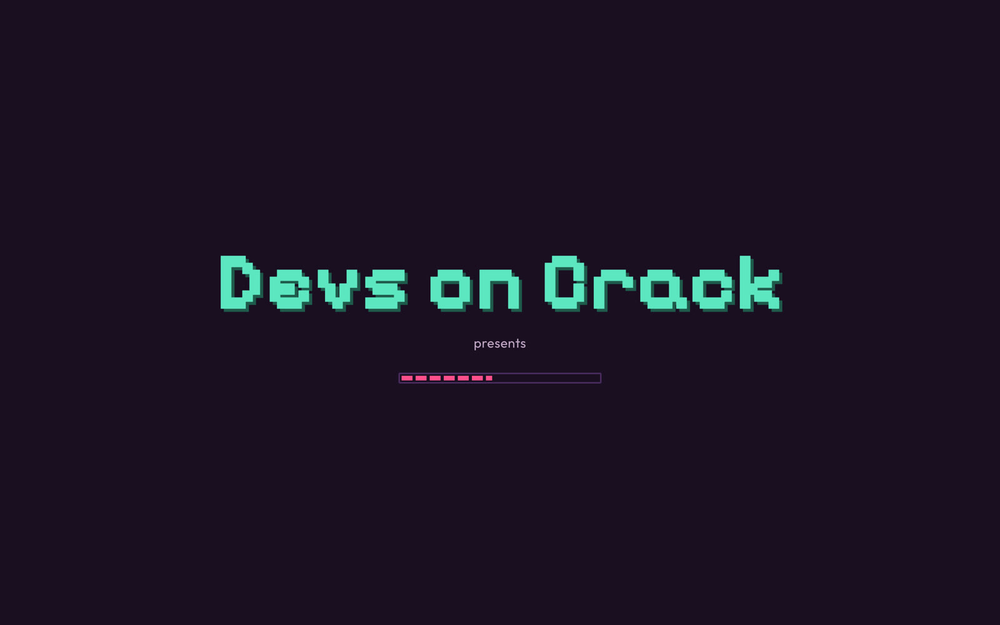
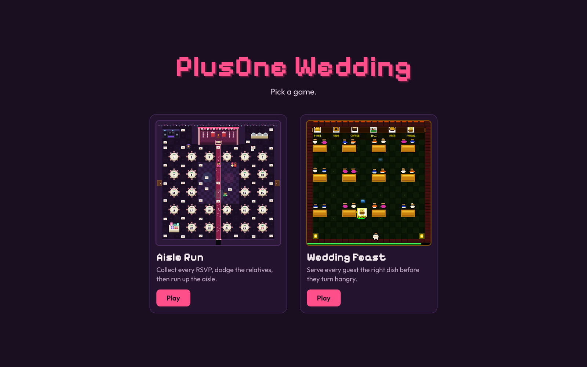
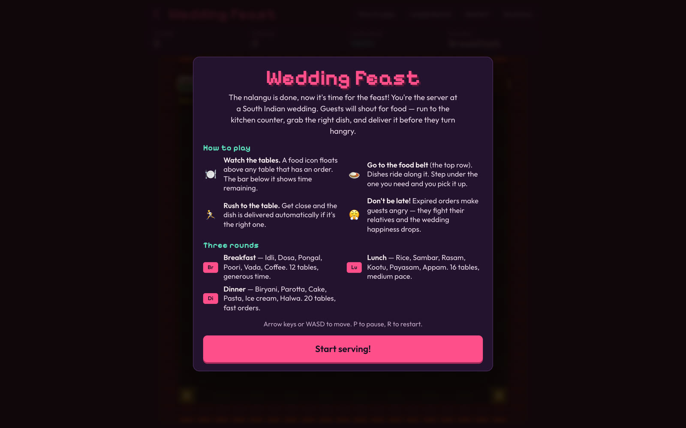
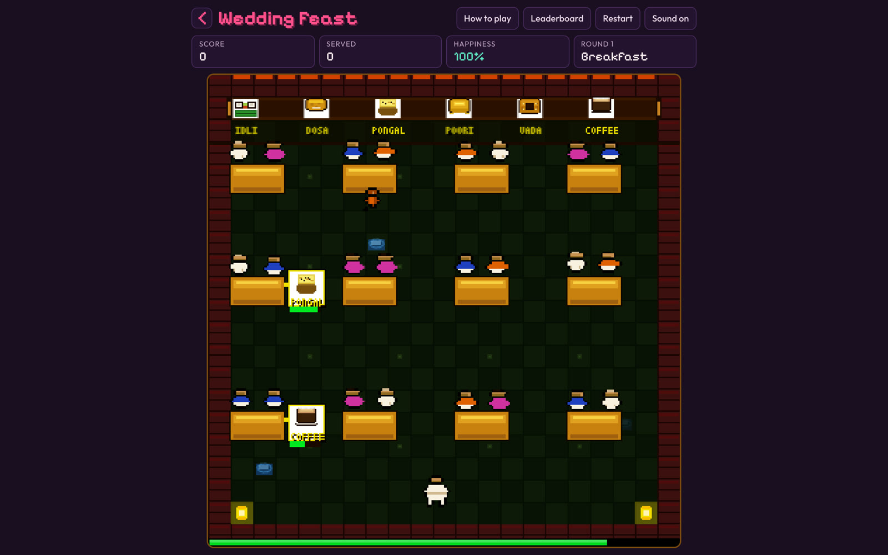
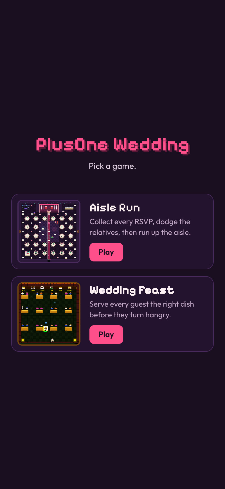

<div align="center">


# PlusOne Wedding

[](https://plusonewedding.site)
[](https://plusonewedding.site/games/aisle-run/)
[](https://plusonewedding.site/games/wedding-feast/)
[](CONTRIBUTING.md)


<table align="center">
  <tr>
    <td align="center" width="200"><br><b>HTML Canvas</b><br><sub>The games. Pixel art drawn in code, at 336 × 336, scaled up crisp.</sub></td>
    <td align="center" width="200"><br><b>Cloudflare Workers</b><br><sub>The platform. Serves the site and every game's leaderboard API.</sub></td>
    <td align="center" width="200"><br><b>Cloudflare D1</b><br><sub>The memory. Keeps every saved name and score, game by game.</sub></td>
  </tr>
</table>


</div>

PlusOne Wedding is a set of pixel games about Indian weddings. They run in any browser, on a phone or a laptop, with nothing to install. The site opens on the Devs on Crack splash, then a game picker. Each game has its own page, its own controls and its own leaderboard.

- **Aisle Run**: the week before the wedding. You're the couple-to-be, collecting every guest's RSVP round a banquet hall while the wedding chaos tries to stop you, then running up the aisle to the mandap.
- **Wedding Feast**: the wedding lunch. You're the server at a South Indian wedding, taking the right dish off the food belt to the right table before the guests turn hangry.

Made by **Devs on Crack**. This repository is the home of the wedding games on plusonewedding.site, and more are on the way.

## How it opens

1. **The splash.** "Devs on Crack" in pixel type over a pixel loading bar. It holds until the fonts and game boards have loaded, then fades to the picker. It shows once per visit, and a click or key press skips it.
2. **The picker.** One card per game: a real frame from the game's board, its name, one line on what you do, and your best score once you've played.
3. **The game.** Every game opens on its rules card with a Start button, so nothing moves until you're ready. The **‹** button at the top left goes back to the picker.

| The splash | The picker |
|---|---|
|  |  |

## Aisle Run

1. **Read the rules.** A pop-up explains the game, the four steps, the power-ups and the chaos before the first game. The **How to play** button brings it back at any time.
2. **Collect every RSVP.** There are 49 envelopes around the hall. You start with **three days** until the wedding, and the days carry across all five levels.
3. **Dodge the chaos.** Each character has its own trick, listed below. A gatecrasher or the budget catching you costs a day.
4. **Grab the power-ups.** The **+1** is a boost, not a life. For a few seconds the chaos panics, and touching them seats them for points. The **extra day** shows up once a level if you've lost a day, and wins it back.
5. **Run up the aisle.** With every RSVP in, the mandap gate opens. Reach it to clear the level and bank a time bonus.

| The rules, before the first game | The board, mid-level |
|---|---|
|  |  |

<p align="center"></p>

| Character | What it does |
|---|---|
| **Aunty Inquiry** | Stops you for a chat ("So when are the kids coming?"). Mash the arrows to excuse yourself. |
| **Gatecrasher** | Walks in through the side doors uninvited, and keeps multiplying: up to 2, then 3, then 4. |
| **Budget Blowout** | An invoice that floats straight over the tables, and speeds up the longer a level runs. |
| **The DJ** | Fires waves of requests you didn't make down the corridors. One hit flips your controls. |

Seated by the +1, Aunty goes to Table 14, far from the mic. The gatecrasher gets a polite name card, the invoice gets negotiated down, and the DJ finally plays your song. Snacks float across the hall for extra points: a laddoo, a mehendi cone, and a slice of cake the caterer swore was gluten-free.

**Levels:** Mehendi, Sangeet, Haldi, Wedding day, Reception. Every level uses the same hall and gets harder: more gatecrashers, a faster budget, a quicker aunty and DJ, and a shorter +1.

## Wedding Feast

1. **Watch the tables.** A dish floats above every table with an order, and the bar under it is the time left.
2. **Go to the food belt.** Dishes ride along the belt at the top of the hall. Step under the one a table wants and you pick it up.
3. **Rush it over.** Get close to the table and the dish is served. A fast delivery scores 250, a slower one 175, a late-but-made-it one 100.
4. **Don't be late.** An order that runs out starts a fight between relatives, and the wedding's happiness drops. At zero, the feast is over.
5. **Watch your step.** A monkey crashes the hall and slows you down if it catches you, and stepping in a sambar puddle with a dish in hand makes you drop it.

| The rules, before the first round | Breakfast, with two orders up |
|---|---|
|  |  |

| Round | Tables | Dishes | Pace |
|---|---|---|---|
| **Breakfast** | 12 | Idli, Dosa, Pongal, Poori, Vada, Coffee | Generous time, a slow belt |
| **Lunch** | 16 | Rice, Sambar, Rasam, Kootu, Payasam, Appam | Medium |
| **Dinner** | 20 | Biryani, Parotta, Cake, Pasta, Ice cream, Halwa | Fast orders, a fast belt |

Clearing a round banks a bonus of 5 points for every percent of happiness left.

## Leaderboards

Each game has its own public leaderboard. At game over, or after the last level or round, players put their name on it. The top 20 show from the **Leaderboard** button.

<p align="center"></p>

On a phone, the picker becomes a list and every game gets a direction pad:

<p align="center">&nbsp;&nbsp;&nbsp;</p>

## Checked

| What | Result | How |
|---|---|---|
| One screen, no scroll | Fits at 1280 × 800, 1440 × 900, 390 × 750 and 360 × 740, on the picker and both games | Headless Chrome with CDP device emulation, `scrollHeight` against `clientHeight` and `scrollWidth` against `clientWidth`, 2 November 2026 |
| Top bars on phones | No button runs past the 16 px gutter at 390 or 360 wide | Same run |
| Wedding Feast name entry | Typing "Sandra wade" into the name box keeps every letter; P pauses and Esc resumes | Real key events through CDP |
| Live site | `/`, both games and both leaderboard APIs return 200; old `/?beat=` links redirect to Aisle Run | `curl` against plusonewedding.site |

## The tech, part by part

| Part | Built with | What it does |
|---|---|---|
| Splash and picker | `public/index.html`, `public/home.css` | The Devs on Crack loading screen, then one card per game with a frame from its board and the player's best score. |
| Game engines | Plain JavaScript and HTML Canvas, `public/games/<game>/game.js` | Each game draws a 336 × 336 board and scales it up pixel-sharp. Aisle Run is a 21 × 21 tile hall with turn buffering and breadth-first pathfinding for the chasers; Wedding Feast is a tile hall with a moving food belt, timed orders and roaming hazards. Both run a frame loop with a capped time step. |
| Pixel art | String-map sprites in each game's `game.js` | Every character, table, dish and pickup is drawn from code. |
| Sound | Web Audio API | Tunes, beats and every sound effect are synthesised in the browser. No audio files. |
| Page and layout | Each game's `index.html` and `style.css` | One screen with no scrolling: the board grows to fit, with a touch pad on phones. Pixelify Sans and Outfit from Google Fonts. |
| Hosting | Cloudflare Workers with static assets, `worker.js`, `wrangler.toml` | Serves `plusonewedding.site` and redirects `www` to the apex. Old `/?beat=N` share links redirect to Aisle Run. |
| Leaderboard APIs | `worker.js` | Aisle Run: `POST /api/run` starts a run, `POST /api/score` saves one score per run, `GET /api/leaderboard` returns the top 20. Wedding Feast has the same three under `/api/feast/`. |
| Leaderboard data | Cloudflare D1 `plusone-wedding-scores`, `schema.sql` | `runs` and `scores` for Aisle Run, `feast_runs` and `feast_scores` for Wedding Feast. |
| Fair play | `worker.js` | Each run saves once, names with common English and Hindi slurs are refused, and a score must be reachable in the time played. Aisle Run allows up to 500 points a second; Wedding Feast up to 200 a second, a maximum of 40,000, and later rounds only after the time it takes to reach them. |

## Run it yourself

You need a current Node LTS, and a Cloudflare account for the leaderboards.

```bash
gh repo clone padmanabhan-r/plusonewedding-games && cd plusonewedding-games
npx wrangler d1 execute plusone-wedding-scores --local --file schema.sql   # local database, once
npx wrangler dev                                                           # site and leaderboard APIs on http://localhost:8787
```

The games also run without the API (the leaderboards just won't load):

```bash
cd public && python3 -m http.server 8788
```

Deploy to the live site. Apply the schema first whenever `schema.sql` gains a table; every statement is `IF NOT EXISTS`, so it's safe to re-run:

```bash
npx wrangler d1 execute plusone-wedding-scores --remote --file schema.sql
npx wrangler deploy
```

There are no environment variables. The Worker's only bindings are `ASSETS` (the `public/` folder) and `DB` (the D1 database), both in `wrangler.toml`.

## Status and limits

Live at [plusonewedding.site](https://plusonewedding.site) with two games, sound, keyboard and touch controls, and a leaderboard for each.

- All five Aisle Run levels share one hall layout.
- The fair-play checks stop casual cheating, not a determined script.
- Each leaderboard shows the top 20; ranks beyond that are only shown to the player who saved.

## Next steps

- **More games:** more wedding-themed games, each in its own folder. [CONTRIBUTING.md](CONTRIBUTING.md) has the steps.
- **New Aisle Run levels:** new halls with their own layouts.
- **Weekly leaderboards:** a this-week board beside the all-time one, for every game.

## Adding a game

Each game is self-contained in `public/games/<slug>/` and gets one card on the picker. [CONTRIBUTING.md](CONTRIBUTING.md) lists what every game needs: a Start button, the home button, one screen at the three sizes, and its own leaderboard routes and tables. It also covers how to open a pull request.

## Repository

| Path | What it is |
|---|---|
| `public/index.html`, `public/home.css` | The Devs on Crack splash and the game picker (home page) |
| `public/games/aisle-run/` | Aisle Run: `index.html`, `game.js` (map, sprites, movement, chasers, power-ups, sound, leaderboard client), `style.css`, `thumb.png` |
| `public/games/wedding-feast/` | Wedding Feast: `index.html`, `game.js` (hall, food belt, orders, hazards, sound, leaderboard client), `style.css`, `thumb.png` |
| `public/og.png`, `public/favicon.svg` | Share card and icon, shared by every page |
| `worker.js` | Cloudflare Worker: static files, redirects, both leaderboard APIs |
| `schema.sql` | D1 tables for both games' runs and scores |
| `wrangler.toml` | Worker name, custom domains, assets and D1 bindings |
| `CONTRIBUTING.md` | How to set up, where a game goes, what it needs, and how to open a pull request |
| `assets/` | README banner (with its HTML source in `assets/src/`), screenshots and logos |

Check every script parses before deploying:

```bash
for f in worker.js public/games/*/game.js; do node --check "$f" || exit 1; done
```
