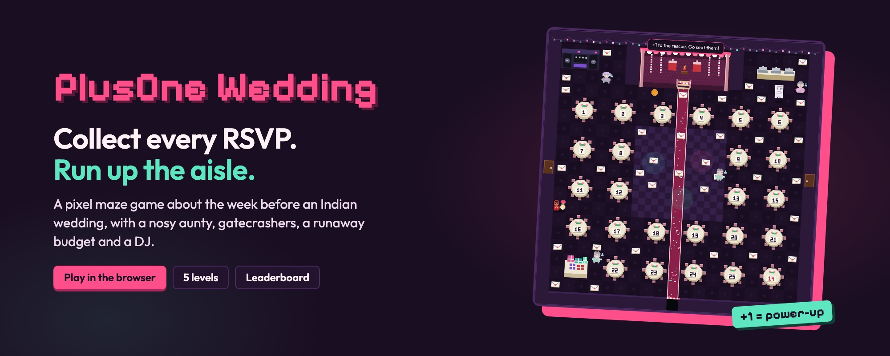
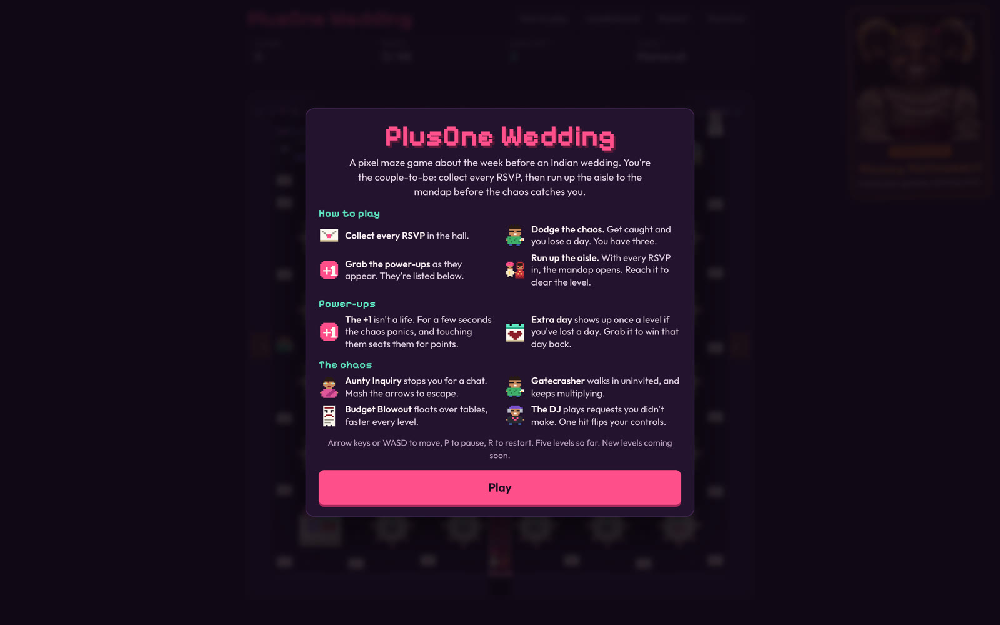
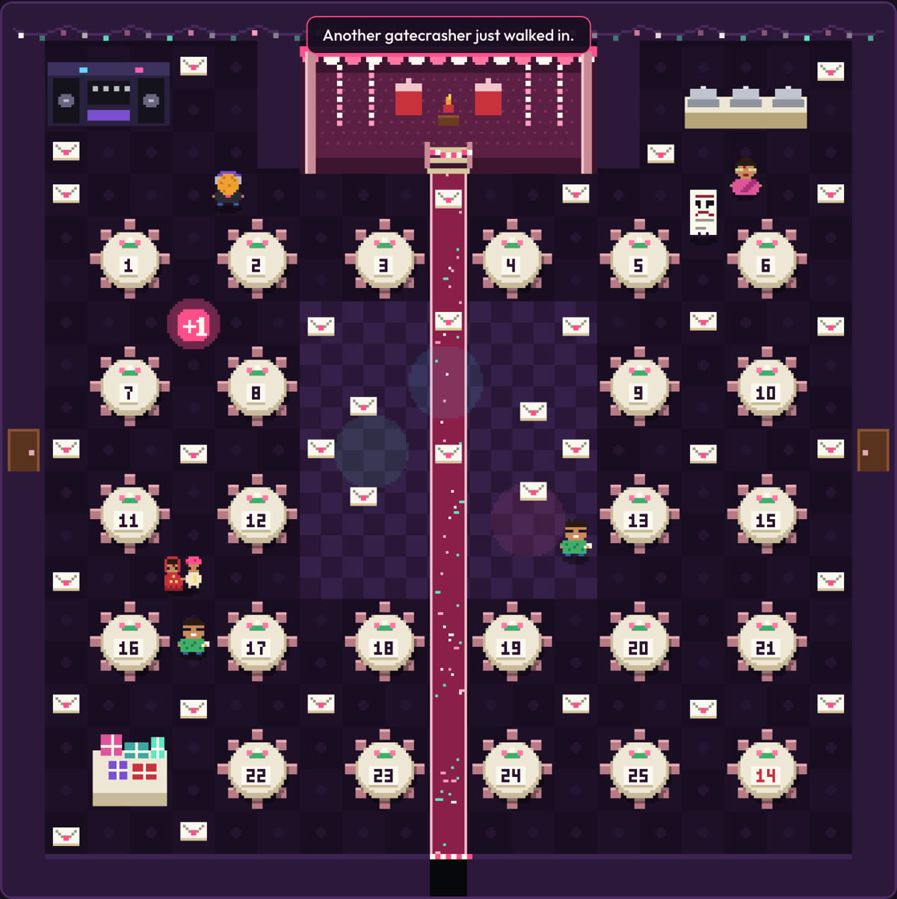
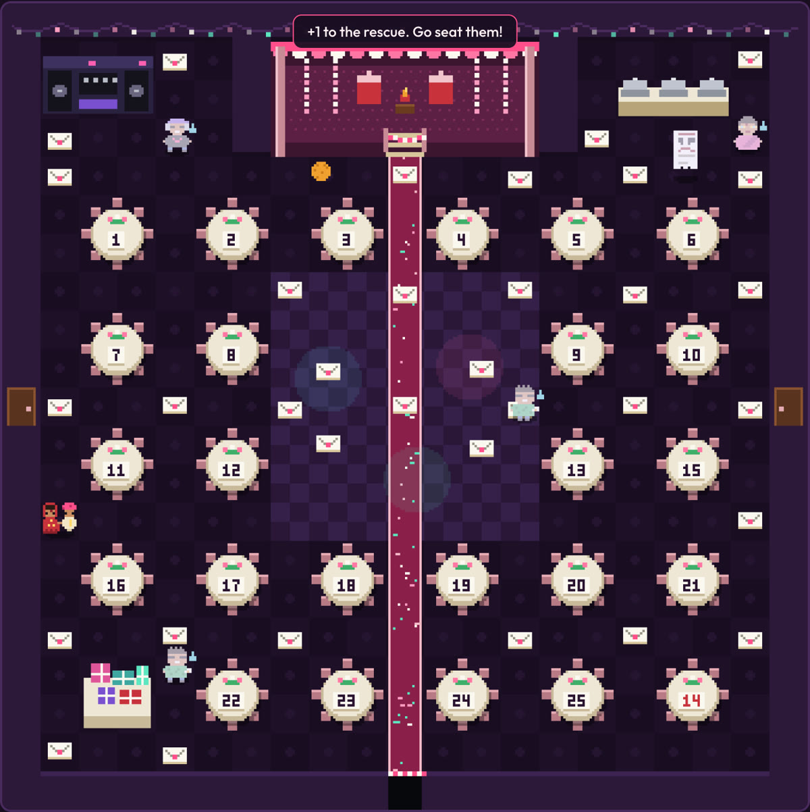
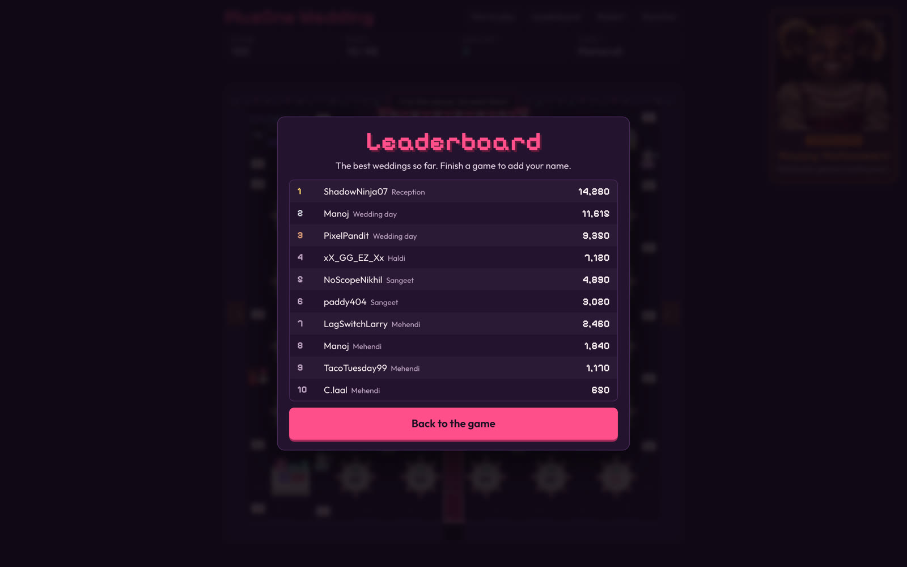
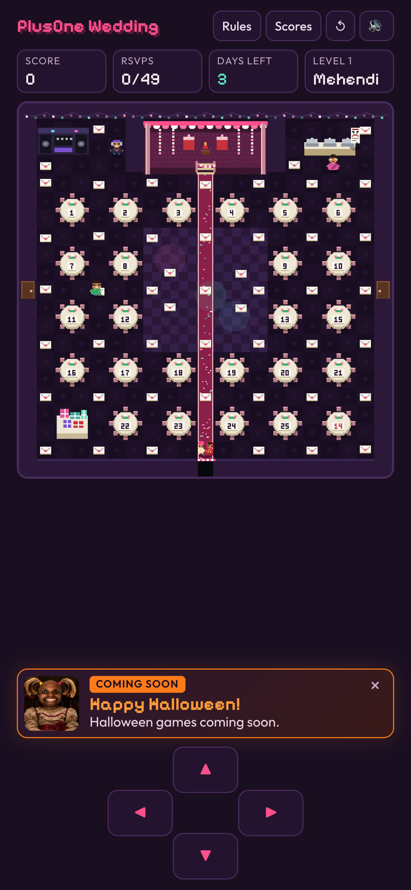

<div align="center">



# PlusOne Wedding

[](https://plusonewedding.site)


<table align="center">
  <tr>
    <td align="center" width="200"><br><b>HTML Canvas</b><br><sub>The game. Pixel art drawn in code, at 336 × 336, scaled up crisp.</sub></td>
    <td align="center" width="200"><br><b>Cloudflare Workers</b><br><sub>The platform. Serves the site and the leaderboard API.</sub></td>
    <td align="center" width="200"><br><b>Cloudflare D1</b><br><sub>The memory. Keeps every saved name and score.</sub></td>
  </tr>
</table>


</div>

PlusOne Wedding is a pixel maze game about the week before an Indian wedding. You play the couple-to-be, racing round a banquet hall to collect every guest's RSVP while the wedding chaos tries to stop you. Get every RSVP in, then run up the aisle to the mandap. It runs in any browser, on a phone or a laptop, with nothing to install.

Made by **Devs on Crack**. This repository is the home of the wedding-themed games on plusonewedding.site.

## How it plays

1. **Read the rules.** A pop-up explains the game, the four steps, the power-ups and the chaos before the first game. The **How to play** button brings it back at any time.
2. **Collect every RSVP.** There are 49 envelopes around the hall. You start with **three days** until the wedding, and the days carry across all five levels.
3. **Dodge the chaos.** Each character has its own trick, listed below. A gatecrasher or the budget catching you costs a day.
4. **Grab the power-ups.** The **+1** is a boost, not a life. For a few seconds the chaos panics, and touching them seats them for points. The **extra day** shows up once a level if you've lost a day, and wins it back.
5. **Run up the aisle.** With every RSVP in, the mandap gate opens. Reach it to clear the level and bank a time bonus.

| The rules, before the first game | The board, mid-level |
|---|---|
|  |  |

<p align="center"></p>

### The chaos

| Character | What it does |
|---|---|
| **Aunty Inquiry** | Stops you for a chat ("So when are the kids coming?"). Mash the arrows to excuse yourself. |
| **Gatecrasher** | Walks in through the side doors uninvited, and keeps multiplying: up to 2, then 3, then 4. |
| **Budget Blowout** | An invoice that floats straight over the tables, and speeds up the longer a level runs. |
| **The DJ** | Fires waves of requests you didn't make down the corridors. One hit flips your controls. |

Seated by the +1, Aunty goes to Table 14, far from the mic. The gatecrasher gets a polite name card, the invoice gets negotiated down, and the DJ finally plays your song. Snacks float across the hall for extra points: a laddoo, a mehendi cone, and a slice of cake the caterer swore was gluten-free.

### Levels

Mehendi, Sangeet, Haldi, Wedding day, Reception. Every level uses the same hall and gets harder: more gatecrashers, a faster budget, a quicker aunty and DJ, and a shorter +1. Clearing Reception says "New levels coming soon."

### Leaderboard

At game over, or after clearing all five levels, players put their name on the public leaderboard. The top 20 show from the **Leaderboard** button.

| The leaderboard | On a phone |
|---|---|
|  |  |

## The tech, part by part

| Part | Built with | What it does |
|---|---|---|
| Game engine | Plain JavaScript and HTML Canvas, `public/game.js` | A 21 × 21 tile hall drawn at 336 × 336 and scaled up pixel-sharp. Grid movement with turn buffering, breadth-first pathfinding for the chasers, and a frame loop with a capped time step. |
| Pixel art | String-map sprites in `public/game.js` | Every character, table and pickup is drawn from code; the pastel "panic" versions are recoloured at load. |
| Sound | Web Audio API | A shehnai-style tune, dhol beats and every sound effect are synthesised in the browser. No audio files. |
| Page and layout | `public/index.html`, `public/style.css` | One screen with no scrolling: the board grows to fit, with a touch pad on phones. Pixelify Sans and Outfit from Google Fonts. |
| Hosting | Cloudflare Workers with static assets, `worker.js`, `wrangler.toml` | Serves the site on `plusonewedding.site` and `www`, and redirects `www` to the apex. |
| Leaderboard API | `worker.js` | `POST /api/run` starts a run, `POST /api/score` saves one score per run, `GET /api/leaderboard` returns the top 20. |
| Leaderboard data | Cloudflare D1 `plusone-wedding-scores`, `schema.sql` | Two tables: `runs` and `scores`. |
| Fair play | `worker.js` | Each run saves once, a score must be reachable in the time played, and names with common English and Hindi slurs are refused. |

## Run it yourself

You need a current Node LTS, and a Cloudflare account for the leaderboard.

```bash
gh repo clone padmanabhan-r/plusonewedding-games && cd plusonewedding-games
npx wrangler dev          # site and leaderboard API on http://localhost:8787
```

The game also runs without the API (the leaderboard just won't load):

```bash
cd public && python3 -m http.server 8788
```

Deploy to the live site:

```bash
npx wrangler deploy
```

First-time database setup, already done for the live site:

```bash
npx wrangler d1 create plusone-wedding-scores
npx wrangler d1 execute plusone-wedding-scores --remote --file schema.sql
```

There are no environment variables. The Worker's only bindings are `ASSETS` (the `public/` folder) and `DB` (the D1 database), both in `wrangler.toml`.

## Status and limits

Live at [plusonewedding.site](https://plusonewedding.site) with five levels, power-ups, sound, keyboard and touch controls, and a working leaderboard.

- All five levels share one hall layout.
- The fair-play checks stop casual cheating, not a determined script.
- The leaderboard shows the top 20; ranks beyond that are only shown to the player who saved.

## Next steps

- **New levels:** new halls with their own layouts, starting with the Halloween games teased on the site.
- **More games:** more wedding-themed games on plusonewedding.site, each with its own page.
- **Weekly leaderboard:** a this-week board beside the all-time one.

## Repository

| Path | What it is |
|---|---|
| `public/index.html` | The page: top bar, score bar, board, rules and leaderboard pop-ups |
| `public/game.js` | The whole game: map, sprites, movement, chasers, power-ups, sound, leaderboard client |
| `public/style.css` | Layout and look |
| `public/og.png`, `public/favicon.svg` | Share card and icon |
| `public/halloween.jpg` | The Halloween promo card image |
| `worker.js` | Cloudflare Worker: static files, `www` redirect, leaderboard API |
| `schema.sql` | D1 tables for runs and scores |
| `wrangler.toml` | Worker name, custom domains, assets and D1 bindings |
| `assets/` | README banner (with its HTML source), screenshots and logos |

Check the game script parses before deploying:

```bash
node --check public/game.js && node --check worker.js
```
